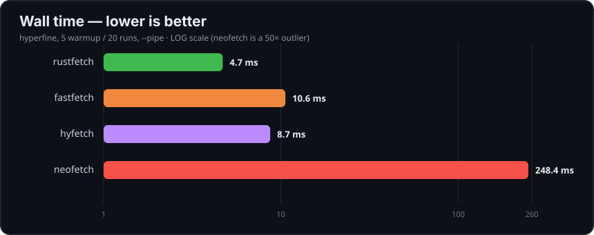
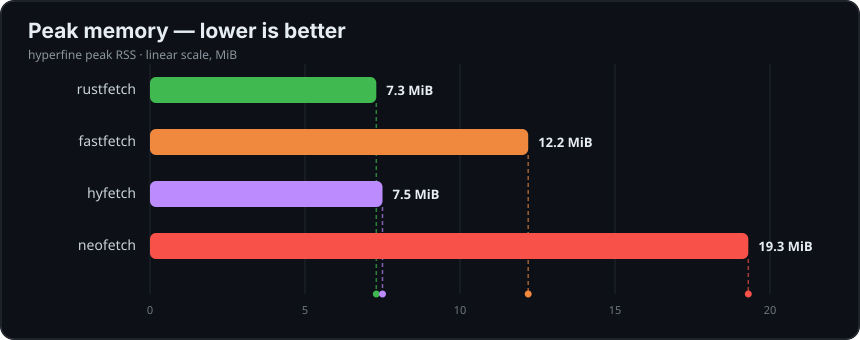

# 🦀 rustfetch

[](https://www.rust-lang.org/)
[](LICENSE)
[](https://kernel.org/)
[](https://github.com/hakergeniusz/rustfetch/releases)
[](https://github.com/fastfetch-cli/fastfetch)

> A **fastfetch-** and **hyfetch-inspired** system information tool, written in Rust.
> Fastfetch's output fidelity, HyFetch's pride flags, ~4 ms startup, one static binary.

<p align="center">
  
</p>

---

## ⚡ Install

### Linux

```sh
curl -fsSL https://hakergeniusz.github.io/rustfetch/install.sh | sh
```

Works in bash, zsh or POSIX sh. The one-liner downloads the release asset,
verifies its SHA-256, installs a `0755` binary to `~/.local/bin` (or
`/usr/local/bin` as root) and a zsh completion to `share/zsh/site-functions`.
**No fastfetch installation required.** Debian/Ubuntu (`.deb`), Fedora/RHEL
(`.rpm`) and Arch (`PKGBUILD`, binary `PKGBUILD`) packages are in
[`packaging/`](packaging/).

Build from source: `cargo build --release` → `target/release/rustfetch`.

### macOS

Homebrew:

```sh
brew tap hakergeniusz/rustfetch
brew trust hakergeniusz/rustfetch   # required by newer Homebrew for third-party taps
brew install rustfetch
```

Or the same curl one-liner (works in bash and zsh):

```sh
curl -fsSL https://hakergeniusz.github.io/rustfetch/install.sh | sh
```

### Windows

PowerShell one-liner:

```powershell
irm https://hakergeniusz.github.io/rustfetch/install.ps1 | iex
```

No PowerShell? Download `rustfetch-setup.exe` from the
[latest release](https://github.com/hakergeniusz/rustfetch/releases/latest),
double-click it, and it downloads, verifies and installs the binary for you.
It is a per-user install with no admin rights required. See
[docs/windows-installer.md](docs/windows-installer.md) for options and notes.

---

## 🪟 Other platforms

**Linux remains the parity target** — the main crate targets full
byte-for-byte fastfetch 2.71.0 parity. The native Windows and macOS builds are
standalone, core-module ports, **not** parity builds. See
[docs/platform-support.md](docs/platform-support.md) for the support matrix,
build commands and known limitations.

Both ports provide the core modules (`title`, `os`, `host`, `kernel`, `uptime`,
`shell`, `terminal`, `cpu`, `memory`, `disk`, `localip`) and the `--pipe`,
`--format json`, `--help`, `--version`, `--list-modules` and
`--hyfetch-preset` flags. The Homebrew tap is published alongside each release;
you can also install the formula directly from a checkout
(`brew install ./installers/rustfetch.rb`) or build from source, as described
in the platform doc.

---

## 🎨 Showcase

[`examples/showcase.jsonc`](examples/showcase.jsonc) — a fastfetch-style layout
with HyFetch's transgender flag gradient:

```bash
rustfetch --config examples/showcase.jsonc
```

The block below uses illustrative popular-spec data (not live output). To render the
config with colors preserved even when stdout is redirected, use
[`scripts/showcase.sh`](scripts/showcase.sh); `--out FILE` (or `--png FILE`)
writes the ANSI-colored capture for a screenshot.

```
      /\          user@archlinux
     /  \         ----------------
    /    \        OS  Arch Linux x86_64
   /      \       Host  ASUS ROG CROSSHAIR X870E HERO
  /   ,,   \      Kernel  Linux 7.3.5-zen1-1-zen
 /   |  |   \     Uptime  181 days, 6 hours, 7 mins
/_-''    ''-_\    Shell  zsh 5.9
                  Display  27" 2560x1440 @ 560 Hz
                  CPU  AMD Ryzen 9 9950X3D2 (16) @ 4.30 GHz
                  GPU 1  AMD Radeon Graphics [Integrated]
                  GPU 2  NVIDIA RTX PRO 6000 Blackwell 96GB [Discrete]
                  GPU 3  NVIDIA RTX PRO 6000 Blackwell 96GB [Discrete]
                  Memory  96.2 GiB / 192.0 GiB (50%)
                  Swap  12.4 GiB / 69.0 GiB (18%)
                  Disk  7.2 TiB / 16.0 TiB (45%) - btrfs
```

In a real terminal the logo is colored with the exact flag RGB values
`#55CDFD → #F6AAB7 → #FFFFFF → #F6AAB7 → #55CDFD`, spread once across every
line — byte-for-byte identical to HyFetch 2.1.1.

---

## ✨ Features

- **Byte-for-byte fastfetch 2.71.0 parity** in pipe, TTY and JSON modes,
  verified across the default preset, 76 modules, all built-in distro logos and
  the full CLI surface. Enable it with `RUSTFETCH_PARITY_VERSION=1 rustfetch`:
  this pins the upstream version string, forces fastfetch's
  `disableLinewrap=false` default so overlong lines are left to the terminal
  instead of being cut, and switches the Display module to fastfetch's
  sysfs-DRM detection. Automated comparisons cover every distro logo, 12
  locale/terminal/session environments and raw PTY output from 20 to 200
  columns; see [parity testing](docs/fastfetch-parity-testing.md). Normal
  invocations keep rustfetch's own defaults (including cutting overlong lines).
- **Format-args engine** — every module's custom `format` string supports
  `{}`/`{N}`/`{name}`, conditionals, colors, padding, truncation, constants
  and ranges.
- **HyFetch mode** — 134 vendored presets, exact OKHSL lightness, 24-bit and
  256-color output, per-line gradients; enabled with `--hyfetch-preset NAME`
  or `"logo": { "hyfetch": { "preset": "NAME" } }`.
- **Module-specific custom keys** — `{index}`, `{name}`, `{type}`, `{guid}`
  etc. expand through the prebuilt-key layouts.
- **`--gen-config`**, `--format json`, `--pipe`, watch mode, key languages,
  per-module formatters, image-protocol logos, spin logo and zsh completion.
- **Fast**: no subprocesses in the hot path; reads procfs/sysfs/DMI directly.

---

## 📊 Benchmarks

`hyperfine` (5 warmup / 20 runs), same machine, `--pipe` where supported.
Lower is better. Full script: [`scripts/compare-tools.sh`](scripts/compare-tools.sh).





| Tool | Wall time | Memory | vs rustfetch |
|---|---:|---:|---|
| **rustfetch 0.2.9** | **4.7 ms ± 0.3** | **7.3 MiB** | — |
| fastfetch 2.71.0 | 10.6 ms ± 0.5 | 12.2 MiB | 2.2× slower, 1.7× RAM |
| hyfetch 2.1.1 | 8.7 ms ± 0.5 | 7.5 MiB | 1.8× slower, +3% RAM |
| neofetch 7.1.0 | 248.4 ms ± 9.8 | 19.3 MiB | 52.5× slower, 2.6× RAM |

> Neofetch was removed from Arch's repos; the benchmark runs its upstream
> standalone shell script from RAM rather than installing it system-wide.

---

## 🚀 Usage

```bash
rustfetch                       # default preset, logo auto-detected
rustfetch os cpu gpu            # only these modules, in this order
rustfetch --hyfetch-preset progress
rustfetch --hyfetch-preset rainbow --hyfetch-mode 8bit
rustfetch --config examples/showcase.jsonc
rustfetch --list-modules
rustfetch --logo none           # no logo
rustfetch --small               # small logo variant when available
rustfetch --pipe                # plain key: value lines for scripting
rustfetch --format json         # JSON, one object per module
rustfetch --gen-config -        # print the default JSONC config template
```

Colors follow `NO_COLOR` and are disabled automatically when stdout isn't a
TTY. All 109 documented fastfetch flags plus the rustfetch-only
`--hyfetch-*` flags are supported.

---

## 🧩 Config & completion

Existing fastfetch configs work unchanged — rustfetch reads
`~/.config/fastfetch/config.jsonc` for compatibility. Add `"logo": { "hyfetch": … }`
to enable flag colors. Unknown flags are rejected with upstream-style errors.

A zsh completion (`completions/_rustfetch`) covers every flag, enum value,
config file, module name, logo name and all 134 HyFetch presets. Installers
place it in `share/zsh/site-functions`; add that dir to `$fpath` before
`compinit` if installing manually.

---

## 🏗️ Build

```bash
cargo build --release
```

Only dependency: `libc`. GPU detection reads `pci.ids` (Arch: `hwdata`,
Debian: `pci.ids`); GNOME display detection uses `gdbus`.

---

## 🙏 Credits

- [fastfetch](https://github.com/fastfetch-cli/fastfetch) — logo database,
  color tables, module behavior and CLI surface (MIT).
- [hyfetch](https://github.com/hykilpikonna/hyfetch) — pride-flag presets and
  OKHSL color math; presets vendored with attribution (MIT).
- [neofetch](https://github.com/dylanaraps/neofetch) and
  [macchina](https://github.com/Macchina-CLI/macchina) — design references.

## 📄 License

MIT — see [LICENSE](LICENSE).
